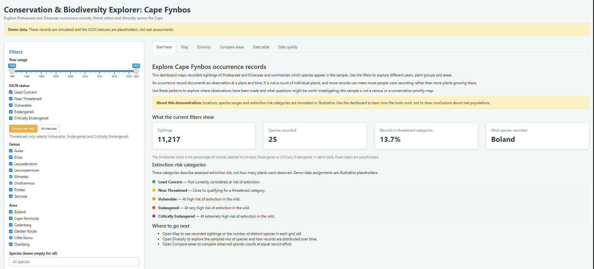

# Conservation & Biodiversity Explorer: Cape Fynbos

An interactive R Shiny dashboard for exploring Proteaceae and Ericaceae occurrence records in the Western Cape: where they are recorded, their illustrative threat statuses, and how diverse different areas look once survey effort is taken into account.

> **Demo data.** The included pipeline simulates 12,000 GBIF-style records across Protea, Leucospermum, Leucadendron, Mimetes, Serruria, Orothamnus, Aulax and Erica. Species ranges and IUCN statuses in the demo data are illustrative placeholders, not real assessments. The app shows a banner while demo data is in use. Real GBIF data drops into the same pipeline (see below).

## What it does

- **Start here**: plain-language introduction, live summaries of filtered records, and an explanation of extinction-risk categories
- **Map**: species richness per grid cell by default, with individual records coloured by IUCN status as an alternate view
- **Diversity**: sightings and species counts, an intuitive variety score, a different-species chance, a recording-over-time chart, a species accumulation curve and the most-recorded species
- **Compare areas**: two areas side by side, including *rarefied* richness so the better-surveyed area doesn't win just by having more records
- **Data quality**: how many records each cleaning step removed
- Filters for year, IUCN status, genus, area and species, plus CSV download of the filtered data
- A **Threatened only** shortcut for Vulnerable, Endangered and Critically Endangered categories

## Reading the dashboard

- Map dots are occurrence records, not individual plants. The richness map counts distinct recorded species in each grid cell; its cell size also defines the survey sites used for the accumulation curve.
- The variety score shows the effective number of equally common species. The different-species chance estimates how often two randomly selected sightings would represent different species. Neither estimates plant abundance.
- The accumulation curve adds grid cells in random order and tracks how many distinct species are found. A curve still rising at the end suggests additional sampling may find more.
- The area comparison includes rarefied richness: expected species at the same number of occurrence records in each area. It helps account for unequal record counts, but does not remove all sampling bias.
- The data-quality tab reports removals sequentially; a record is attributed to the first cleaning rule it fails.
- “Threatened” refers to Vulnerable, Endangered and Critically Endangered categories. Near Threatened is shown separately.

## What this shows (ecologically)

- Occurrence data is cleaned the way an ecologist would: missing and zero coordinates, coordinates outside South Africa (including swapped lat/lon), imprecise records, bad years, non-species names and duplicates are removed, and every step is logged.
- Survey effort is treated as a real problem: a records-per-year chart, a species accumulation curve showing whether sampled cells continue to add species, and rarefied richness for comparison.
- Diversity indices are calculated on record counts per species, so they describe the sampled records rather than true abundance.

## Stack

R, Shiny, tidyverse, vegan (diversity, accumulation, rarefaction), leaflet, DT, testthat.

## Setup

Requires R 4.1 or newer.

```r
install.packages(c("shiny", "tidyverse", "leaflet", "vegan", "DT", "testthat"))
```

From the project root:

```r
shiny::runApp()
```

The included cleaned data lets the app start immediately. To regenerate the simulated data and cleaning log first, run `source("data-raw/build_data.R")`. Map tiles are served by OpenStreetMap and require an internet connection; no API key is needed.

## Tests

```r
testthat::test_dir("tests/testthat")
```

The tests check diversity and rarefaction against hand-calculated values, and cover name normalization, cleaning removals, region assignment, zero-coordinate handling, map grid cells and repeatable species accumulation.

## Using real GBIF data

1. Download records (see `data-raw/00_optional_download_gbif.R` for the rgbif route, or the manual steps in its header).
2. Save them as `data-raw/raw_occurrences.csv`. Comma or tab separated both work.
3. Optionally add `data-raw/iucn_status.csv` with columns `species,iucn_status`. Species missing from it become "Not Evaluated".
4. Run `source("data-raw/02_clean_occurrences.R")`, then `shiny::runApp()`.

Note: the area comparison uses six Cape reference regions defined in `R/helpers.R` (`CAPE_REGIONS`). Records far from all of them are labelled "Other".

## Project structure

```
app.R                          Shiny app (UI + server)
R/helpers.R                    cleaning, grid cells, diversity, rarefaction (pure functions)
data-raw/                      data scripts: simulate, clean, optional GBIF download
data/                          cleaned data and cleaning log (generated)
tests/testthat/                unit tests
```
## Screenshots:


